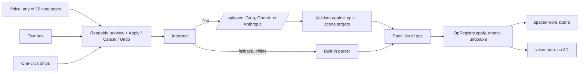

# Specter

**Interactive 3D for the web that you can build and edit by speaking.** Specter is a cloneable kit built on Three.js. Say or type “add a hotspot on the nucleus about DNA” or “paint the sofa blue”. Specter turns the sentence into a validated **Spec**, shows you what it will change, and applies it to the scene on Apply. Undo is always available.

Built with [Kiro](https://kiro.dev) for Kiroween 2026, category **Skeleton Crew**.

| App | What it is | Folder |
|---|---|---|
| **LearnForge** | Education explorer: an animal cell, the solar system and DNA, with clickable explanations | `apps/learnforge` |
| **HauntHouse Walk** | Guided apartment tour with room cards. Redecorate and leave notes by voice | `apps/haunthouse-walk` |
| **Crypt Forge** | Product configurator for a lantern. Panel controls and voice produce the same Spec | `apps/crypt-forge` |
| **Studio** | Start from an empty scene. “Build a solar eclipse”, “add a triceratops”, “make the moon orbit the earth”, “when I click the sun, show …” | `apps/studio` |

Live: [LearnForge](https://specter-learnforge.vercel.app) · [HauntHouse Walk](https://specter-haunthouse-walk.vercel.app) · [Crypt Forge](https://specter-crypt-forge.vercel.app) · [Studio](https://specter-studio.vercel.app) · [Embed demo](https://specter-learnforge.vercel.app/embed/)

## Studio: build from nothing

Studio turns a sentence into a scene in one of four ways, tried in this order:

1. **Recipes** for topics that are arrangements of things: solar eclipse, phases of the Moon, water cycle, atom, volcano, plant cell, simple house. Each one comes with labels, explanations (hotspots), motion and click actions, and works offline.
2. **Free model libraries** for real-world things: [Poly Haven](https://polyhaven.com) (CC0, no key), [Poly Pizza](https://poly.pizza) (CC0 and CC BY, free key), [Smithsonian Open Access](https://www.si.edu/openaccess) (only CC0 records, free key), and a built-in catalogue of Khronos sample models. Matches are shown as choices, sized to a typical real-world height, and their credits are kept.
3. **Composition**: for simple things with no recipe (a snowman, a molecule, a bar chart), the AI builds them from up to 30 named shapes.
4. **Generation** (optional): “generate a stone gargoyle” uses [Meshy](https://www.meshy.ai) when `MESHY_API_KEY` is set (a paid Meshy plan). It runs in the background and asks for confirmation when ready.

Then edit by voice or with the panels: move, rotate, scale, put on top of, duplicate in a row/ring/grid, colour, finish, hide, delete, spin, orbit, float, pulse, click and hover actions, and environments (studio, indoor, daylight, sunset, night, space). The transform handle (W/E/R) and every panel button produce the same validated, undoable Specs as speech. **Play** mode runs the click actions; share links and embeds open in Play mode.

Scenes autosave in the browser, and can be saved/opened as files, shared by link, embedded, or exported as GLB with the credits written into the file.

**Licensing.** Only CC0 and plain CC BY models are used, from allowlisted hosts. The credits panel lists every author, plus “Models provided by Poly Pizza” and “Powered by Poly Haven” as their API terms require. Models load from the providers' own servers; Specter never re-hosts or mirrors their catalogues. Poly Pizza's API terms do not allow commercial use by anyone earning more than $50,000 a year, so check them before you deploy commercially.

## Who it is for

- **Teachers and course authors:** add or rewrite explanations on a 3D model without touching code, then share a link or embed it in an LMS.
- **Tour and property authors:** turn one prepared model into a guided walkthrough you can annotate.
- **Developers:** get scene setup, loading, hotspots, materials, camera paths, disposal and a safe voice pipeline already built and tested. Add a new 3D app with little new code.

Use cases the kit supports: classroom science, museum and heritage tours, real-estate showings, interior previews, product training.

## How it works



A Spec is a short list of edit operations, not a whole scene:

```json
{ "version": 1, "ops": [{ "op": "setMaterial", "mesh": "sofa", "color": "#2563eb" }] }
```

Ops: `addHotspot`, `updateHotspot`, `removeHotspot`, `addNote`, `setMaterial`, `setVisibility`, `setCamera`, `loadPack`. Every answer from the AI is checked against the same op schemas and against the names of things that actually exist in the scene. Unknown ops and unknown targets are rejected. If the AI is slow, down, or returns something invalid, the built-in parser handles the command instead, so the apps work with the network off.

## Packages

| Package | Purpose |
|---|---|
| `specter-voice` | Engine-agnostic. Op registry, Zod schemas, offline parser, AI client, command flow, voice input, read-aloud, share links, server handler. **No Three.js.** |
| `specter-library` | Model search (Poly Haven, Poly Pizza, Smithsonian, catalogue) and Meshy generation, with license records and a host allowlist. **No Three.js**, runs on the server |
| `specter-core` | Three.js scene, GLB loader (Draco + Meshopt), lighting presets with image-based light, ACES tone mapping, shadows, optional ambient occlusion and bloom, hotspots, materials, camera paths, budget checks, disposal, Gaussian splat loading, and the Studio world: objects, copies, lights, motion, interactions, environments, recipes, GLB export |
| `specter-ui` | Shared React UI: canvas host, command bar, toolbar, theme |
| `specter-viewer` | `<specter-viewer>` web component for any HTML page |
| `specter-r3f` | Thin React Three Fiber adapter (`<SpecterBridge>`) |

Examples: `examples/voice-todo` (the voice pipeline with no 3D at all) and `examples/r3f-demo`.

## Run it

Requires Node 20+ and pnpm 10.

```bash
pnpm install
pnpm dev:learnforge     # http://localhost:5173
pnpm dev:walk           # http://localhost:5174
pnpm dev:forge          # http://localhost:5175
pnpm --filter studio dev   # http://localhost:5178
```

AI interpretation is optional. To enable it, copy `.env.example` to `.env.local` at the repo root and set `GROQ_API_KEY` (or `OPENAI_API_KEY` / `ANTHROPIC_API_KEY`). Without a key, everything runs on the built-in parser. For Studio, `POLY_PIZZA_API_KEY` and `SMITHSONIAN_API_KEY` add those libraries (Poly Haven and the catalogue need no key), and `MESHY_API_KEY` turns on generation.

```bash
pnpm test          # unit + property-based tests (Vitest + fast-check)
pnpm test:e2e      # Playwright, against local dev servers
pnpm build         # all packages and apps
```

URL flags: `?demo=1` (demo badge), `?nollm=1` (skip the AI), `?quality=standard|cinematic`, `?pack=cell|solar-system|dna`, `?embed=1` (no chrome, for iframes), `?spec=...` (share link).

## Using your own models

```bash
pnpm models:audit path/to/model.glb --init-config   # mesh names, triangles, warnings, writes a sidecar
pnpm models:optimize path/to/model.glb              # Draco + WebP + resize
```

- LearnForge: put `cell.glb` (+ `cell.config.json`) in `apps/learnforge/public/models/`.
- HauntHouse Walk: `apartment.glb` (+ `apartment.config.json` with `tour`, `hotspots`, `aliases`) in `apps/haunthouse-walk/public/models/`.
- Scan scene: `place.spz` (or `.ply` / `.splat`) in the same folder adds a “Real place (scan)” button.

If a file is missing or fails to load, the app uses its procedural model. Voice commands can only target **named** meshes, so the audit warns when a model has generic names like `Object_12`. See `assets/ATTRIBUTIONS.md` for licensing.

## Embed

```html
<script type="module" src="https://specter-learnforge.vercel.app/embed/specter-viewer.js"></script>
<specter-viewer src="model.glb" hotspots='[{"mesh":"door","title":"Front door","body":"Solid oak."}]'></specter-viewer>
```

Each app's Share button also produces an iframe snippet.

## Built with Kiro

`.kiro/` holds the specs (EARS requirements, design, tasks), steering (3D architecture, performance budget, voice-authoring rules), hooks and custom agents. `powers/specter-3d/` is a Kiro Power. See `docs/KIRO-WRITEUP.md` and `docs/BUGS-CAUGHT.md`.

## Limits

- Studio builds scenes from recipes, shapes, free library models and (optionally) AI generation. Results are stylised or library models, not photoreal scenes on demand. Library search quality depends on the libraries, and some requests find nothing.
- Generated models need a paid Meshy plan, take 1 to 3 minutes, and Meshy's download links expire, so export the scene to keep them.
- The other three apps edit prepared models. None of the apps generate photoreal buildings from speech.
- No physics simulation and no multiplayer.
- Voice input uses the browser's speech recognition, which works in Chrome and Edge. Other browsers use the text box with the same features.
- Gaussian splat scans support camera moves and position-anchored hotspots only, because scans have no named parts.
- Procedural models are stylised, and sizes in the solar system are compressed to fit on screen.

## License

MIT. See `LICENSE`.
